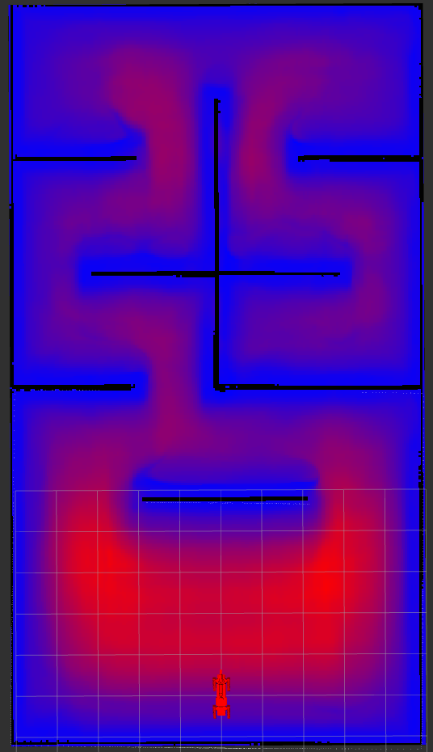
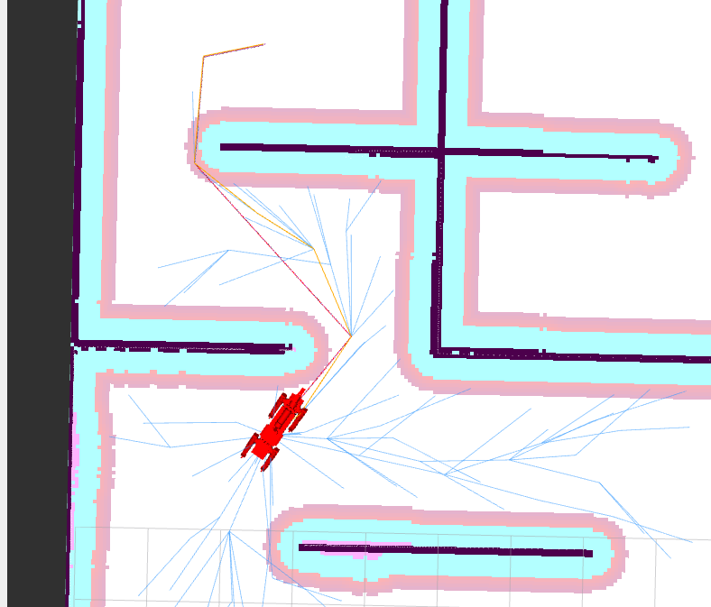

# Webots ROS2 Spot

[](https://github.com/MASKOR/webots_ros2_spot/actions/workflows/test_ros2_humble.yml)

This is a ROS 2 package to simulate the Boston Dynamics spot in [webots](https://cyberbotics.com/). Spot is able to walk around, to sit, standup and lie down. We also attached some sensors on spot, like a kinect and a 3D laser.
The world contains apriltags, a red line to test lane follower and objects for manipulation tasks.


## Prerequisites

    - Ubuntu 22.04
    - ROS2 Humble https://docs.ros.org/en/humble/Installation/Ubuntu-Install-Debians.html
    - Webots 2025a https://github.com/cyberbotics/webots/releases/tag/R2025a

## Install

1. Install ROS2 Development tools and initialise and update rosdep:
    ```
    sudo apt install -y ros-dev-tools
    ```
    ```
    source /opt/ros/humble/setup.bash
    sudo rosdep init
    rosdep update
    ```

2. Create a new ROS2 workspace:
    ```
    export COLCON_WS=~/ros2_ws
    mkdir -p $COLCON_WS/src
    ```

3. Pull relevant packages, install dependencies, compile, and source the workspace by using:
    ```
    cd $COLCON_WS
    git clone -b psbd_spot https://github.com/Jabkowski/webots_ros2_spot_poisson_cbf src/webots_ros2_spot
    vcs import --recursive src --skip-existing --input src/webots_ros2_spot/webots_ros2_spot.repos
    ln -s $COLCON_WS/src/webots_ros2_spot/webots_spot_rrt_cbf $COLCON_WS/src/webots_spot_rrt_cbf
    rosdep install --ignore-src --from-paths src -y -r
    chmod +x src/webots_ros2/webots_ros2_driver/webots_ros2_driver/ros2_supervisor.py
    ```

4. Build packages and source the workspace
    ```
    colcon build --symlink-install
    source install/setup.bash
    ```

## Start
Starting the simulation:
```
ros2 launch webots_spot spot_launch.py
```

To launch navigation with Rviz2:
```
ros2 launch webots_spot nav_launch.py set_initial_pose:=true
```

To launch mapping with Slamtoolbox:
```
ros2 launch webots_spot slam_launch.py
```

Starting MoveIt:
```
ros2 launch webots_spot moveit_launch.py
```

Teleop keyboard:
```
ros2 run teleop_twist_keyboard teleop_twist_keyboard
# OR ros2 run spot_teleop spot_teleop_keyboard for body_pose control as well
```

## RrtCbf planner (Safe CBF-RRT* global planner)

`webots_spot_rrt_cbf` is a Nav2 global planner plugin (`RrtCbf`) shipped in this repo and symlinked into `src/` in the install step. It needs the PINN safety field published by the `pinn_safety` node, which runs inference with an external PINN repo.

1. Install PyTorch (CPU is enough) and numpy: `pip3 install torch numpy`
2. Clone the PINN repo at the pinned commit (branch `pinn`). It contains the model code (`models/`) and the release weights (`results/release_weights/`) needed for inference:
    ```
    git clone -b pinn https://github.com/Jabkowski/Poisson-Safety-Boundary-Determiner.git ~/Poisson-Safety-Boundary-Determiner
    git -C ~/Poisson-Safety-Boundary-Determiner checkout 993cc12ece5cbec98d6a3ad66e1a1b7ba3191032
    ```
3. `params/pinn_safety.yaml` already expects this location (`pinn_root: ~/Poisson-Safety-Boundary-Determiner`, `~` is expanded). The weights and normalisation stats are read from `results/release_weights/` relative to `pinn_root`. If you cloned elsewhere, only change `pinn_root`. The node imports `models.double_unet` from there.
4. Rebuild if needed and start navigation with the planner (`pinn_safety` is started automatically):
    ```
    ros2 launch webots_spot nav_launch.py set_initial_pose:=true planner:=rrt_cbf
    ```
   Default is `planner:=navfn`. See [webots_spot_rrt_cbf/README.md](webots_spot_rrt_cbf/README.md) for the benchmark and unit tests.

PINN Poisson safety field `h` on the occupancy map (red = safer, blue = near obstacles):



Example RRT*-CBF tree and path on the same map:



## To switch Arenas

1) Change false to true in https://github.com/MASKOR/webots_ros2_spot/blob/main/resource/spot_control.urdf#L5

2) Change map.yaml to map_arena3.yaml https://github.com/MASKOR/webots_ros2_spot/blob/main/launch/nav_launch.py#L15 (map of arena 2 not created)
